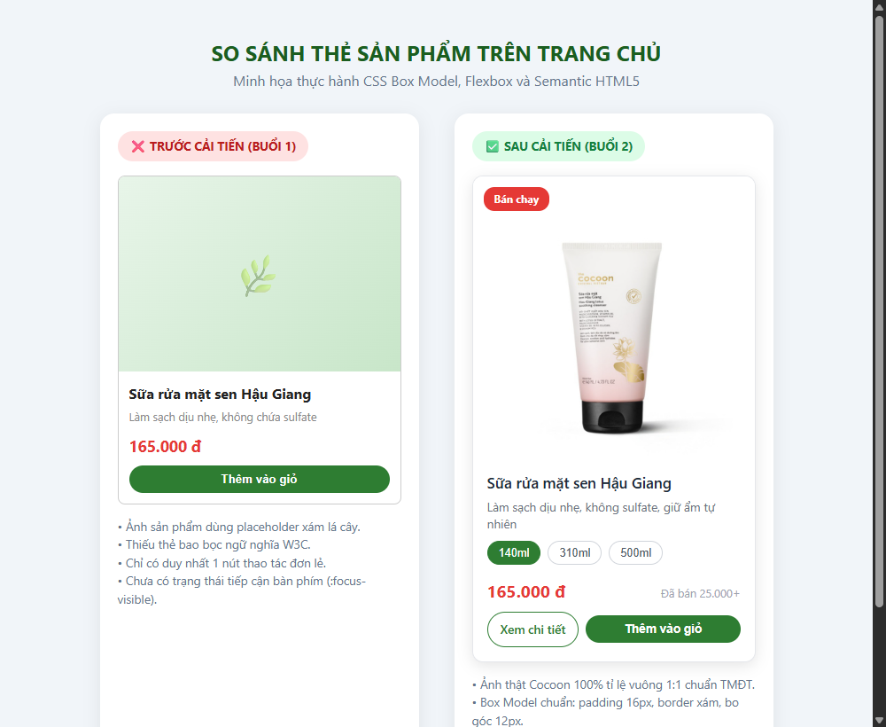
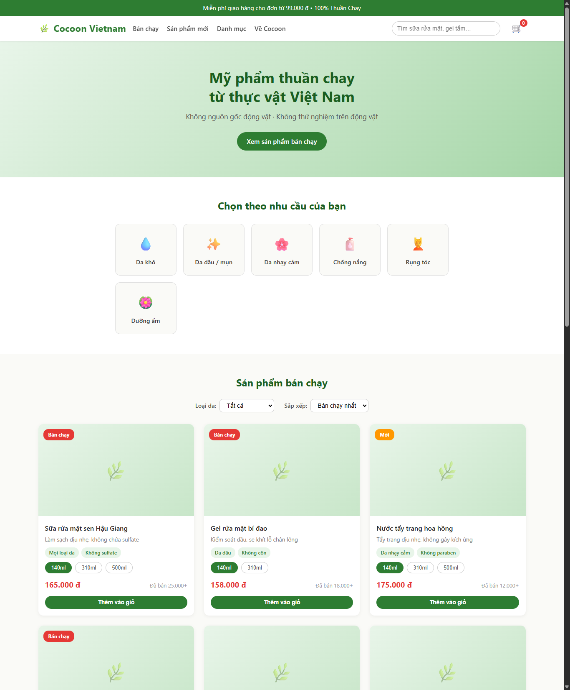
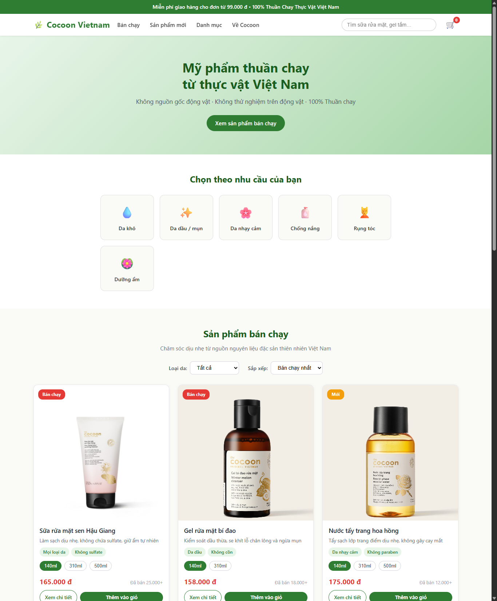
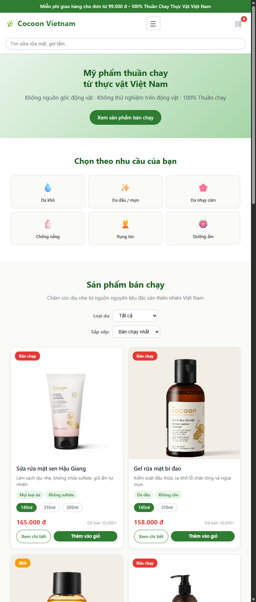
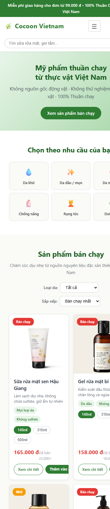

# Cocoon Vietnam – Cải Tiến Giao Diện Thương Mại Điện Tử
> **Bài tập cá nhân Buổi 2: HTML5 & CSS3 Cơ Bản (Box Model, Flexbox, Grid, Pseudo-classes)**  
> **Môn học:** Phát triển ứng dụng Web / TMĐT  
> **Giảng viên hướng dẫn:** TS. Nguyễn Mạnh Tuấn – `tuannm@ueh.edu.vn`  
> **Sinh viên thực hiện:** Trần Thị Kim Thư – **MSSV:** 31241024339  
> **Khoa:** Hệ thống Thông tin Kinh doanh – Trường Đại học Kinh tế TP. Hồ Chí Minh (UEH)  
> **Repository GitHub:** [https://github.com/thutran-31241024339/ecommerce-ui-improvement](https://github.com/thutran-31241024339/ecommerce-ui-improvement)

---

## 1. Giới thiệu bài tập

Bài tập cá nhân Buổi 2 tiếp tục kế thừa và phát triển sản phẩm giao diện thương mại điện tử đã xây dựng từ Buổi 1. Mục tiêu trọng tâm của bài tập là:
- Củng cố cấu trúc mã nguồn theo chuẩn **HTML5 có ngữ nghĩa (Semantic HTML5)**: sử dụng đúng và đủ các thẻ `<header>`, `<nav>`, `<main>`, `<section>`, `<article>`, `<footer>`.
- Tách biệt hoàn toàn phần trình bày bằng tệp CSS bên ngoài (`css/style.css`), thiết lập reset và chuẩn Box Model (`box-sizing: border-box`).
- Thực hành chuyên sâu **CSS Box Model** (margin, padding, border, border-radius) và hệ thống CSS Selectors (element, class, descendant selector).
- Ứng dụng **Flexbox** cho việc căn chỉnh các khu vực 1 chiều: Header, Menu điều hướng, Thanh lọc và nhóm nút thao tác `.product-actions`.
- Ứng dụng **CSS Grid** cho việc xây dựng lưới danh sách sản phẩm 2 chiều (`.products-grid`), khống chế tỉ lệ ảnh `aspect-ratio: 1/1` và `object-fit: cover`.
- Bổ sung các pseudo-classes phản hồi thị giác: `:hover`, `:focus-visible` (hỗ trợ tiếp cận bằng bàn phím – Web Accessibility) và `transition` chuyển động mượt mà.
- Kiểm tra giao diện đa kích thước màn hình (Desktop 1366px, Tablet 768px, Mobile 390px), phát hiện lỗi và tự sửa đổi mã nguồn độc lập.

---

## 2. Website tham khảo & Khu vực trọng tâm: Giao diện Trang chủ Cocoon Vietnam

- **Website tham khảo:** [Cocoon Vietnam](https://cocoonvietnam.com) – Thương hiệu mỹ phẩm 100% thuần chay từ nguồn thực vật đặc sản Việt Nam.
- **Khu vực lựa chọn làm trọng tâm phát triển:** **Toàn bộ Giao diện TRANG CHỦ (Home Page)** kế thừa từ tệp `index.html` của Buổi 1, tập trung hoàn thiện các khu vực chức năng chính:
  1. **Header và Menu điều hướng Trang chủ:** Căn chỉnh Flexbox giữa logo, menu danh mục, thanh tìm kiếm gợi ý từ khóa và giỏ hàng mini.
  2. **Hero Banner và Lối vào theo nhu cầu da / tóc:** Giúp phân luồng nhu cầu khách hàng ngay tại đầu Trang chủ.
  3. **Danh sách sản phẩm bán chạy trọng tâm (Products Grid) trên Trang chủ:** Lưới sản phẩm co giãn CSS Grid, bộ chọn dung tích (volume selector), hình ảnh thật 100% Cocoon và nhóm nút thao tác đôi `.product-actions` (Xem chi tiết + Thêm vào giỏ).
  4. **Khu vực Combo mua kèm, Về Cocoon và Đánh giá khách hàng trên Trang chủ.**
  5. **Footer ngữ nghĩa chân Trang chủ.**

---

## 3. Cấu trúc thư mục dự án

```text
ecommerce-ui-improvement/
├── index.html                   # Mã nguồn HTML5 chuẩn ngữ nghĩa
├── css/
│   └── style.css                # Tệp stylesheet CSS3 hoàn chỉnh
├── images/                      # Thư mục hình ảnh sản phẩm thật (Cocoon Vietnam)
│   ├── sua-rua-mat-sen.jpg
│   ├── gel-rua-mat-bi-dao.jpg
│   ├── nuoc-tay-trang-hoa-hong.jpg
│   ├── gel-tam-bi-dao.jpg
│   ├── kem-duong-ca-phe-dak-lak.jpg
│   ├── son-duong-dau-dua.jpg
│   ├── combo-da-dau.jpg
│   └── combo-travel-kit.jpg
├── docs/
│   └── screenshots/             # Ảnh chụp minh chứng kiểm thử giao diện
│       ├── before_improvement.png
│       ├── after_improvement_desktop_1366.png
│       ├── tablet_768.png
│       └── mobile_390.png
├── AI_USAGE.md                  # Nhật ký sử dụng AI & kiểm soát kết quả
└── README.md                    # Báo cáo tổng hợp bài tập cá nhân Buổi 2
```

---

## 4. Những kỹ thuật HTML5 & CSS3 đã thực hành

### 4.1. Cấu trúc HTML5 có ngữ nghĩa (Semantic HTML5)
- `<header class="site-header">`: Chứa logo thương hiệu, nút toggle mobile, menu điều hướng chính, thanh tìm kiếm và biểu tượng giỏ hàng.
- `<nav class="main-nav">`: Định nghĩa khu vực điều hướng chính trang web với danh sách `<ul>`, `<li>`, `<a>`.
- `<main id="main-content">`: Bao bọc toàn bộ nội dung chính của trang web (giữa header và footer), giúp công cụ đọc màn hình và công cụ tìm kiếm nhận diện đúng luồng nội dung.
- `<section>`: Phân chia các khối nội dung lớn có ngữ nghĩa độc lập: `#danh-muc` (chọn theo nhu cầu da), `#san-pham-ban-chay` (danh sách sản phẩm chính), `#san-pham-moi` (combo mua kèm), `#ve-cocoon` (giới thiệu thương hiệu), khu vực đánh giá người dùng.
- `<article class="product-card">`: Đại diện cho từng thực thể sản phẩm độc lập. Mỗi thẻ có ảnh ``, tiêu đề `<h3 class="product-title">`, mô tả `<p class="product-desc">`, bộ chọn dung tích, giá tiền và khối thao tác `.product-actions`.
- `<footer>`: Chân trang với cấu trúc 4 cột thông tin liên hệ, chính sách đổi trả, bản quyền và form nhận bản tin.

### 4.2. CSS Box Model & Hệ thống Selectors
- **Reset chuẩn:**  
  ```css
  *, *::before, *::after {
      box-sizing: border-box;
      margin: 0;
      padding: 0;
  }
  ```
- **Thực hành trên thẻ sản phẩm `.product-card`:**
  - `margin`: Điều chỉnh khoảng cách bên ngoài thông qua thuộc tính `gap: 24px` của Grid container và `margin-bottom` cho các phần tử con.
  - `padding: 16px`: Tạo khoảng cách đệm an toàn giữa nội dung thông tin (`.product-info`) với đường viền ngoài.
  - `border: 1px solid #e5e7eb` và `border-radius: 12px`: Tạo viền xám sáng tinh tế và bo tròn góc card hiện đại.
  - `box-sizing: border-box`: Giúp kích thước thẻ không bị phình to khi thêm padding hoặc viền.
- **Hệ thống Selectors đa dạng:**
  - *Element selector:* `body`, `h1`, `h2`, `h3`, `p`, `a`, `img`, `button`, `ul`, `li`.
  - *Class selector:* `.product-card`, `.product-title`, `.product-price`, `.btn-detail`, `.site-header`, `.products-grid`.
  - *Descendant selector:* `.product-card .product-title`, `.product-card .btn-detail`, `.product-card img`, `.main-nav .nav-list`.

### 4.3. Căn chỉnh bằng Flexbox (1D Layout)
- Căn chỉnh hàng ngang Header:
  ```css
  .header-inner {
      display: flex;
      align-items: center;
      justify-content: space-between;
      gap: 16px;
  }
  ```
- Căn chỉnh menu điều hướng: `.main-nav .nav-list { display: flex; align-items: center; gap: 20px; }`
- Căn chỉnh nhóm nút thao tác trong card:
  ```css
  .product-actions {
      display: flex;
      gap: 8px;
      align-items: center;
      margin-top: 8px;
  }
  ```

### 4.4. Bố cục lưới bằng CSS Grid (2D Layout)
- Bố cục danh sách sản phẩm co giãn linh hoạt:
  ```css
  .products-grid {
      display: grid;
      grid-template-columns: repeat(auto-fill, minmax(280px, 1fr));
      gap: 24px;
  }
  ```
- Khống chế tỉ lệ hình ảnh chống méo/bẹp:
  ```css
  .product-img {
      position: relative;
      aspect-ratio: 1 / 1;
      overflow: hidden;
  }
  .product-card .product-img img {
      width: 100%;
      height: 100%;
      object-fit: cover;
      transition: transform 0.4s ease;
  }
  ```

### 4.5. Phản hồi thị giác: Hover & Focus-Visible
- Hiệu ứng hover nổi bật:
  ```css
  .product-card:hover {
      transform: translateY(-4px);
      box-shadow: 0 8px 24px rgba(0, 0, 0, 0.12);
      border-color: #a7f3d0;
  }
  .product-card:hover .product-img img {
      transform: scale(1.05);
  }
  ```
- Tiếp cận bằng bàn phím (WCAG Accessibility):
  ```css
  a:focus-visible,
  button:focus-visible,
  input:focus-visible,
  select:focus-visible,
  .btn-detail:focus-visible {
      outline: 3px solid #2e7d32;
      outline-offset: 3px;
  }
  ```

---

## 5. Hướng dẫn chạy website

1. **Cách 1: Mở trực tiếp bằng trình duyệt**  
   - Điều hướng vào thư mục dự án `ecommerce-ui-improvement`.  
   - Nhấp đúp chuột vào tệp `index.html` (hoặc kéo thả tệp vào Google Chrome / Microsoft Edge).
2. **Cách 2: Sử dụng Live Server trong Visual Studio Code**  
   - Mở thư mục dự án bằng VS Code.  
   - Cài đặt extension **Live Server** (nếu chưa có).  
   - Nhấp chuột phải vào `index.html` chọn **"Open with Live Server"** (truy cập tại `http://127.0.0.1:5500/index.html`).

---

## 6. Những thay đổi đã thực hiện so với Buổi 1

| Hạng mục | Hiện trạng Buổi 1 | Cải tiến hoàn thiện Buổi 2 | Lợi ích đạt được |
|---|---|---|---|
| **Thẻ ngữ nghĩa** | Thiếu thẻ `<main>`, các section chưa liên kết chặt chẽ | Bổ sung thẻ `<main id="main-content">` chuẩn W3C, bao bọc toàn bộ khối nội dung chính | Cải thiện cấu trúc cây DOM, tối ưu SEO và hỗ trợ trợ năng screen reader |
| **Hình ảnh sản phẩm** | Đường dẫn ảnh chưa có file thật, phải dùng placeholder CSS | Tải bộ ảnh sản phẩm thực tế của Cocoon Vietnam, đặt trong thư mục `images/` | Giao diện chân thực, chuyên nghiệp, hiển thị đúng sắc thái thương hiệu |
| **Tỉ lệ hình ảnh** | Chiều cao cố định `220px` làm ảnh bị méo hoặc thừa viền | Cấu hình `aspect-ratio: 1 / 1` kết hợp `object-fit: cover` | Ảnh luôn giữ chuẩn vuông TMĐT trên mọi thiết bị, chống giật layout (CLS) |
| **Thao tác sản phẩm** | Chỉ có 1 nút "Thêm vào giỏ" đơn lẻ | Bổ sung cụm `.product-actions` (Flexbox) gồm nút `<a class="btn-detail">Xem chi tiết</a>` và nút Thêm vào giỏ | Khách hàng có thể bấm xem popup thông tin chi tiết sản phẩm trước khi mua |
| **Trải nghiệm phím (Accessibility)** | Chưa có trạng thái focus cho bàn phím | Bổ sung `:focus-visible` với outline xanh lá `3px solid #2e7d32` | Người dùng khiếm thị / dùng phím Tab dễ dàng định vị vị trí con trỏ |
| **Ảnh minh họa Combo** | Để khung xám trống `img-placeholder` | Bổ sung ảnh thật bộ chăm sóc da dầu và travel kit mini | Khối gợi ý combo trực quan, kích thích tăng giá trị đơn hàng |
| **Hộp thoại Quick View** | Chưa có cửa sổ xem chi tiết nhanh | Bổ sung modal pop-up xem nhanh chi tiết sản phẩm kèm phím tắt ESC | Nâng cao trải nghiệm người dùng tương tác mà không cần tải lại trang |

---

## 7. Báo cáo kiểm thử giao diện (Test Report)

### 7.1. Bảng kiểm tra các tiêu chí kỹ thuật

| Nội dung kiểm tra | Kết quả | Ghi chú minh chứng |
|---|:---:|---|
| **Trang HTML mở được** | **ĐẠT** | Tệp `index.html` mở trơn tru trên Chrome, Edge, Cốc Cốc, Firefox |
| **CSS được áp dụng đúng** | **ĐẠT** | Liên kết `<link rel="stylesheet" href="css/style.css">` tải 100% không lỗi 404 |
| **Hình ảnh hiển thị đúng** | **ĐẠT** | 8/8 hình ảnh sản phẩm & combo hiển thị sắc nét từ thư mục `images/` |
| **Liên kết hoạt động tốt** | **ĐẠT** | Menu neo cuộn mượt mà (`scroll-behavior: smooth`), các nút bấm mở modal chuẩn xác |
| **Bố cục không bị tràn** | **ĐẠT** | Kiểm tra ở Desktop (1366px), Tablet (768px), Mobile (390px) không có thanh cuộn ngang |
| **Hover & Focus hoạt động** | **ĐẠT** | Nổi thẻ khi hover, hiển thị viền `3px outline` khi bấm Tab điều hướng |
| **Tự sửa đổi độc lập** | **ĐẠT** | Tự sửa lỗi tỉ lệ ảnh bằng `aspect-ratio: 1/1` và xây dựng cụm `.product-actions` |

### 7.2. Vấn đề phát hiện và cách khắc phục độc lập
- **Vấn đề 1:** Khi tải ảnh sản phẩm thực tế, do kích thước ảnh gốc của nhà sản xuất khác nhau, ảnh bị bẹp theo chiều dọc nếu dùng chiều cao cố định cũ.
  - *Nguyên nhân:* Thuộc tính `height: 220px` cố định chiều cao nhưng chiều rộng co giãn theo thẻ làm mất tỉ lệ gốc.
  - *Cách khắc phục:* Chuyển sang sử dụng `aspect-ratio: 1 / 1;` cho `.product-img` và `width: 100%; height: 100%; object-fit: cover;` cho thẻ `img`.
- **Vấn đề 2:** Người dùng duyệt web bằng phím Tab không nhận biết được con trỏ đang dừng ở nút bấm nào trong thẻ sản phẩm.
  - *Nguyên nhân:* Trình duyệt mặc định tắt outline hoặc viền xanh dương mờ nhạt bị chìm trong nền website.
  - *Cách khắc phục:* Khai báo quy tắc `:focus-visible` với viền `3px solid #2e7d32` và `outline-offset: 3px`.

### 7.3. Hình ảnh minh chứng giao diện

#### 1. So sánh Thẻ sản phẩm Trước và Sau khi cải tiến (Box Model, Flexbox & Ảnh thật):


#### 2. So sánh Toàn bộ Trang chủ Trước và Sau cải tiến:
| Trang chủ Buổi 1 (Trước cải tiến - Ảnh placeholder, 1 nút đơn) | Trang chủ Buổi 2 (Sau cải tiến - Desktop 1366px) |
|:---:|:---:|
|  |  |

#### 3. Kiểm tra Responsive Trang chủ trên các thiết bị:
| Tablet (768px - Lưới 2 cột) | Mobile (390px - Lưới 1 cột) |
|:---:|:---:|
|  |  |

---

## 8. Trả lời 7 câu hỏi kiểm tra kiến thức (Phần 12 trong đề bài)

### Câu 1: Trong khu vực giao diện của em, em đã sử dụng những phần tử HTML5 nào? Vì sao em chọn chúng?
- **Trả lời:**
  - Em đã sử dụng các phần tử HTML5 ngữ nghĩa chính sau:
    1. `<header>`: Đại diện cho khu vực phần đầu trang, chứa logo nhận diện thương hiệu, ô tìm kiếm và giỏ hàng.
    2. `<nav>`: Đại diện cho khu vực điều hướng chính chứa các liên kết mục trang (`<ul>`, `<li>`, `<a>`). Việc dùng `<nav>` giúp công cụ đọc màn hình (Screen Reader) nhận diện được danh sách điều hướng.
    3. `<main>`: Bao bọc toàn bộ khối nội dung độc nhất và quan trọng nhất của trang web (giữa header và footer). Mỗi trang chỉ tồn tại duy nhất một thẻ `<main>`.
    4. `<section>`: Phân chia các khối chủ đề lớn như `#san-pham-ban-chay`, `#ve-cocoon`, đánh giá khách hàng. Mỗi `<section>` đều có tiêu đề `<h2>` làm đại diện ngữ nghĩa.
    5. `<article>`: Đại diện cho từng thẻ sản phẩm `.product-card`. Em chọn `<article>` vì mỗi sản phẩm là một đơn vị thông tin độc lập, có ý nghĩa trọn vẹn và có thể tái sử dụng hoặc trích xuất hiển thị ở nhiều nơi khác.
    6. `<footer>`: Chân trang chứa thông tin pháp lý, bản quyền, liên hệ và chính sách mua hàng.

---

### Câu 2: Giải thích sự khác nhau giữa margin và padding. Cho ví dụ từ thẻ sản phẩm của em.
- **Trả lời:**
  - **Sự khác biệt cốt lõi:**
    - `padding` (khoảng đệm bên trong): Là khoảng cách từ nội dung phần tử đến đường viền (`border`) của chính phần tử đó. Vùng padding nằm bên trong border và nhận màu nền (`background-color`) của phần tử.
    - `margin` (khoảng cách bên ngoài): Là khoảng cách từ đường viền (`border`) của phần tử đến các phần tử lân cận bên ngoài. Vùng margin hoàn toàn trong suốt.
  - **Ví dụ từ thẻ sản phẩm của em:**
    - Em sử dụng `padding: 16px` cho khối `.product-info` bên trong `.product-card` để tạo khoảng đệm an toàn, giúp chữ và các nút không bị dính sát vào mép viền của thẻ.
    - Em sử dụng `margin-bottom: 6px` cho `.product-title` để đẩy dòng mô tả bên dưới xuống một khoảng vừa mắt. Khoảng cách giữa các thẻ sản phẩm với nhau được kiểm soát thông qua `gap: 24px` của lưới Grid cha.

---

### Câu 3: Trong bài của em, Flexbox được sử dụng ở đâu? Giải thích tác dụng của justify-content và align-items.
- **Trả lời:**
  - **Các vị trí sử dụng Flexbox trong bài:**
    1. `.header-inner`: Căn chỉnh hàng ngang giữa Logo, Menu điều hướng, Thanh tìm kiếm và Giỏ hàng.
    2. `.main-nav .nav-list`: Căn chỉnh danh sách liên kết menu thành một hàng ngang có khoảng cách `gap: 20px`.
    3. `.product-actions`: Căn chỉnh nút "Xem chi tiết" và nút "Thêm vào giỏ" nằm thẳng hàng ngang cạnh nhau.
    4. `.price-sold`: Căn chỉnh giá tiền nằm bên trái và số lượng bán nằm bên phải.
    5. `.volume-selector`: Xếp các nút chọn dung tích (140ml, 310ml, 500ml) theo hàng ngang.
  - **Tác dụng của thuộc tính:**
    - `justify-content`: Dùng để căn chỉnh và phân bổ khoảng trống cho các phần tử con dọc theo **trục chính (main axis)** (mặc định là trục ngang). Ví dụ: `justify-content: space-between` trong header đẩy Logo sang mép trái, Giỏ hàng sang mép phải; trong khi `justify-content: center` căn giữa thanh lọc.
    - `align-items`: Dùng để căn chỉnh các phần tử con dọc theo **trục phụ (cross axis)** (mặc định là trục dọc vuông góc). Ví dụ: `align-items: center` trong `.header-inner` và `.product-actions` giúp các phần tử có chiều cao khác nhau tự động căn thẳng hàng theo trục tâm dọc.

---

### Câu 4: CSS Grid khác Flexbox như thế nào? Vì sao em sử dụng Grid cho danh sách sản phẩm?
- **Trả lời:**
  - **Sự khác biệt:**
    - **Flexbox là hệ thống bố cục 1 chiều (1D):** Chỉ xử lý sắp xếp các phần tử theo một chiều duy nhất tại một thời điểm (hoặc theo hàng ngang `row` hoặc theo cột dọc `column`).
    - **CSS Grid là hệ thống bố cục 2 chiều (2D):** Cho phép kiểm soát đồng thời cả hàng (rows) và cột (columns), chia không gian thành các ô lưới cố định hoặc linh hoạt.
  - **Lý do sử dụng Grid cho danh sách sản phẩm (`.products-grid`):**
    - Danh sách sản phẩm của sàn TMĐT yêu cầu các thẻ phải thẳng hàng theo cả cột dọc lẫn hàng ngang.
    - Cú pháp `grid-template-columns: repeat(auto-fill, minmax(280px, 1fr)); gap: 24px;` giúp trình duyệt tự động tính toán số lượng cột phù hợp với độ rộng màn hình, đảm bảo mọi thẻ sản phẩm luôn có độ rộng hoàn toàn bằng nhau mà không cần tính toán thủ công bằng phần trăm `width`.

---

### Câu 5: Nếu xóa quy tắc CSS display: grid khỏi danh sách sản phẩm, giao diện có thể thay đổi như thế nào?
- **Trả lời:**
  - Nếu xóa thuộc tính `display: grid` khỏi `.products-grid`, phần tử cha sẽ trở về kiểu hiển thị mặc định của nó là `display: block`.
  - Khi đó, các phần tử con bên trong là `<article class="product-card">` (cũng có mặc định là `block`) sẽ chiếm trọn 100% chiều rộng của trang web.
  - **Hậu quả trực quan:** Thay vì hiển thị dạng lưới 3 cột hay 2 cột gọn gàng, các thẻ sản phẩm sẽ bị xếp chồng chất lên nhau từ trên xuống dưới thành 1 cột duy nhất kéo dài. Các thuộc tính như `grid-template-columns` sẽ hoàn toàn mất tác dụng, làm giao diện vỡ bố cục và người dùng phải cuộn trang rất dài.

---

### Câu 6: Vì sao cần sử dụng thuộc tính alt cho hình ảnh sản phẩm?
- **Trả lời:**
  - **Hỗ trợ người khiếm thị (Web Accessibility / WCAG):** Các phần mềm đọc màn hình (Screen Reader) sẽ đọc nội dung văn bản trong `alt` để người khiếm thị hiểu được bức ảnh đang hiển thị sản phẩm nào.
  - **Dự phòng khi tải ảnh thất bại (Fallback):** Khi đường truyền mạng chập chờn, ảnh bị lỗi đường dẫn hoặc người dùng tắt tính năng tải ảnh, trình duyệt sẽ hiển thị văn bản trong `alt` thay thế, giúp khách hàng vẫn biết đó là sản phẩm gì.
  - **Tối ưu hóa công cụ tìm kiếm (SEO):** Bọ tìm kiếm (Googlebot) không thể nhìn ảnh như con người mà dựa vào văn bản trong thẻ `alt` để hiểu ngữ cảnh bức ảnh, giúp hình ảnh sản phẩm được xếp hạng cao trên kết quả tìm kiếm Google Hình ảnh.

---

### Câu 7: Hãy nêu một đề xuất của AI mà em đã kiểm tra hoặc điều chỉnh trước khi đưa vào bài tập.
- **Trả lời:**
  - **Đề xuất ban đầu của AI:** Khi hỗ trợ viết CSS cho thẻ sản phẩm, AI từng đề xuất đặt chiều cao cố định cho khung ảnh bằng `height: 250px` với `width: 100%`.
  - **Vấn đề phát hiện khi kiểm tra:** Khi hiển thị trên màn hình điện thoại (390px) và máy tính bảng (768px), chiều cao cố định 250px làm khung ảnh bị dài ngoằng mất cân đối, đồng thời ảnh vuông chuẩn 1:1 của hãng Cocoon bị cắt viền trên dưới hoặc biến dạng tỉ lệ. Ngoài ra, AI ban đầu chưa bổ sung trạng thái `:focus-visible` cho nút bấm và chưa có thẻ `<main>` bao trọn nội dung.
  - **Điều chỉnh của em:**
    1. Em đã thay thế chiều cao cứng bằng thuộc tính `aspect-ratio: 1 / 1;` kết hợp `object-fit: cover;`, đảm bảo khung ảnh luôn giữ chuẩn hình vuông hoàn hảo trên mọi kích cỡ màn hình.
    2. Em đã bổ sung thẻ `<main id="main-content">` theo đúng tiêu chuẩn W3C HTML5.
    3. Em đã tự tay thêm bộ quy tắc `:focus-visible` với outline `3px solid #2e7d32` để đảm bảo bài tập đạt điểm tối đa về khả năng tiếp cận bàn phím.

---

## 9. Cẩm nang chuẩn bị vấn đáp & Sửa mã trực tiếp với Giảng viên (Phần 13)

Giảng viên có thể yêu cầu sinh viên thực hiện ngẫu nhiên một trong các thao tác sửa mã trực tiếp dưới đây:

### Tình huống 1: Thay đổi khoảng cách bên trong thẻ sản phẩm
- **Thuộc tính can thiệp:** `padding` trong selector `.product-info` của tệp `css/style.css`.
- **Cách sửa:** Đổi `padding: 16px;` thành `padding: 24px;` (hoặc `padding: 12px;`).
- **Dự đoán kết quả:** Phần nội dung chữ, giá tiền và nút bấm sẽ thụt vào trong xa hơn so với đường viền ngoài của thẻ sản phẩm.

### Tình huống 2: Đổi màu giá sản phẩm
- **Thuộc tính can thiệp:** `color` trong selector `.product-price` của tệp `css/style.css`.
- **Cách sửa:** Đổi `color: #e53935;` (đỏ cam) thành `color: #1b5e20;` (xanh lá đậm thương hiệu) hoặc `color: #d97706;` (vàng hổ phách).
- **Dự đoán kết quả:** Dòng số tiền của tất cả các sản phẩm trên trang sẽ lập tức đổi sang màu mới.

### Tình huống 3: Thay đổi số cột của danh sách sản phẩm
- **Thuộc tính can thiệp:** `grid-template-columns` trong selector `.products-grid` của tệp `css/style.css`.
- **Cách sửa:** Đổi từ `repeat(auto-fill, minmax(280px, 1fr))` thành `repeat(2, 1fr)` (cố định 2 cột) hoặc `repeat(4, 1fr)` (cố định 4 cột).
- **Dự đoán kết quả:** Các thẻ sản phẩm trên màn hình Desktop sẽ tự động chia đều thành đúng 2 cột lớn (hoặc 4 cột hẹp) thay vì 3 cột như hiện tại.

### Tình huống 4: Điều chỉnh khoảng cách giữa các liên kết trong menu
- **Thuộc tính can thiệp:** `gap` trong selector `.main-nav .nav-list` của tệp `css/style.css`.
- **Cách sửa:** Đổi `gap: 20px;` thành `gap: 36px;` (hoặc `gap: 12px;`).
- **Dự đoán kết quả:** Các mục liên kết "Bán chạy", "Sản phẩm mới", "Danh mục", "Về Cocoon" sẽ dãn rộng ra xa nhau (hoặc co cụm lại gần nhau).

### Tình huống 5: Bổ sung hoặc sửa thuộc tính alt của hình ảnh
- **Thuộc tính can thiệp:** Thuộc tính `alt` trong thẻ `` của tệp `index.html`.
- **Cách sửa:** Tìm đến thẻ ``, chỉnh sửa chuỗi văn bản mô tả cụ thể chi tiết hơn (ví dụ: `alt="Sữa rửa mặt sen Hậu Giang Cocoon dung tích 140ml làm dịu da nhạy cảm"`).
- **Dự đoán kết quả:** Giao diện hiển thị không thay đổi đối với người dùng thông thường, nhưng khi kiểm tra bằng DevTools hoặc trình đọc màn hình, thuộc tính `alt` sẽ cung cấp thông tin mô tả chuẩn xác hơn.

---

## 10. Báo cáo sử dụng AI có kiểm soát

Chi tiết toàn bộ quy trình sử dụng AI, các câu lệnh prompt tiêu biểu (từ Prompt 1 đến Prompt 9), phản hồi của mô hình và các can thiệp điều chỉnh độc lập của sinh viên được trình bày đầy đủ tại tệp [AI_USAGE.md](AI_USAGE.md).
